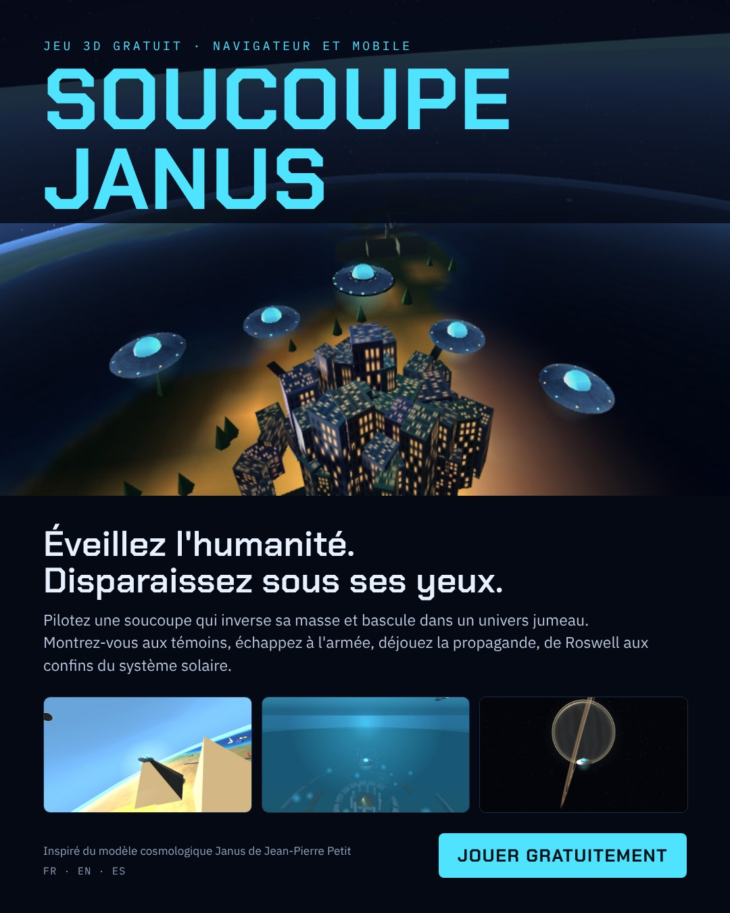
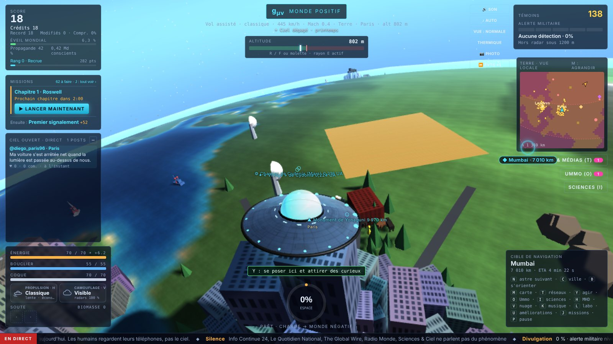
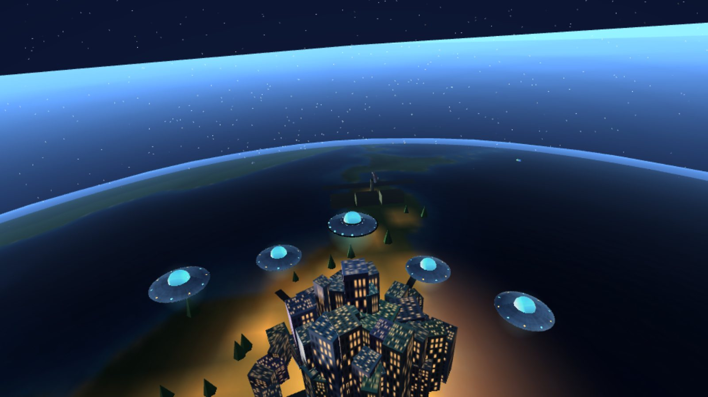
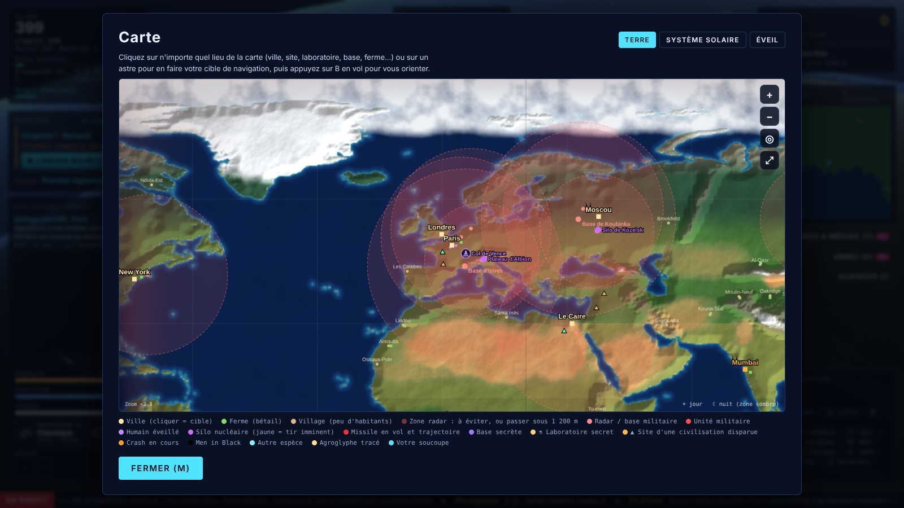
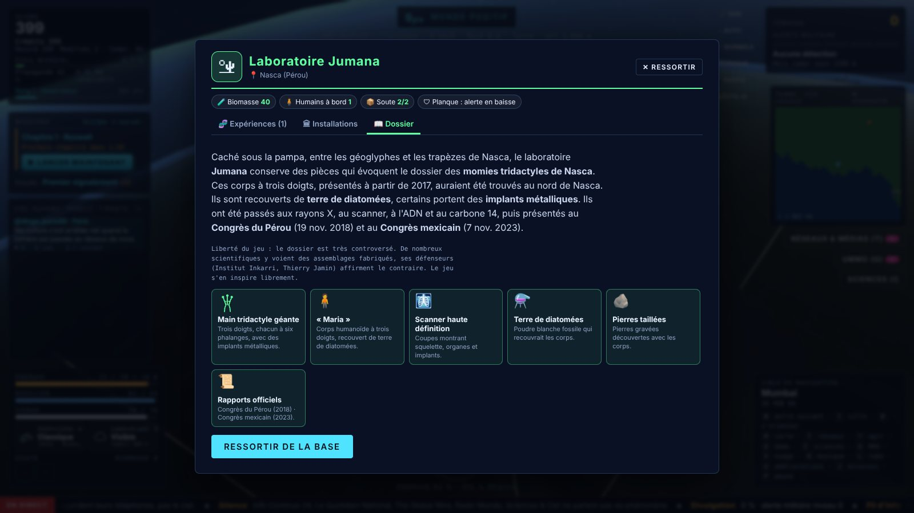
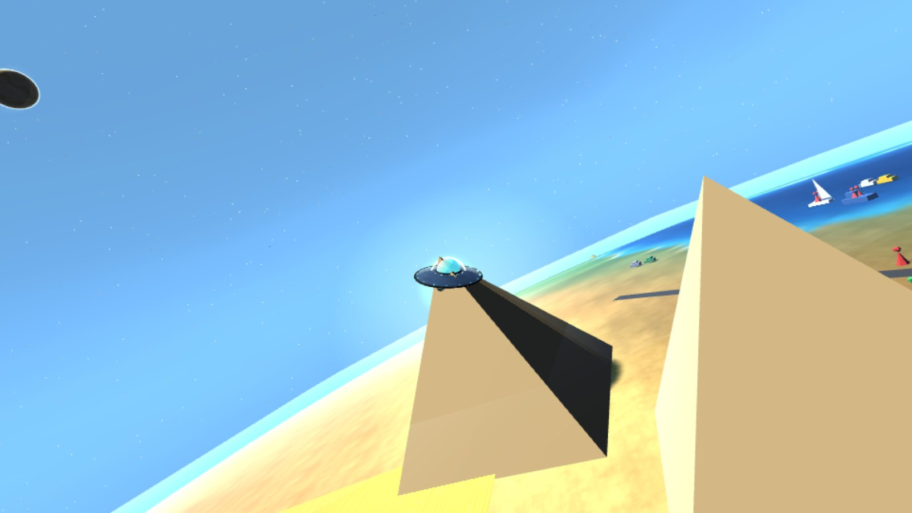
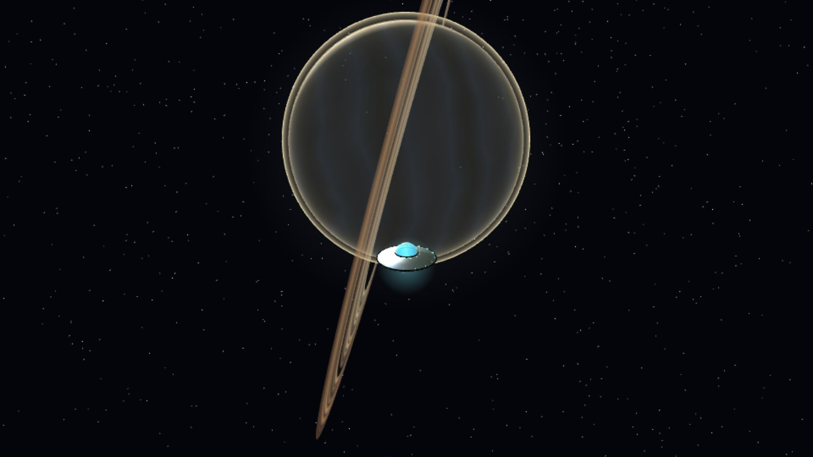
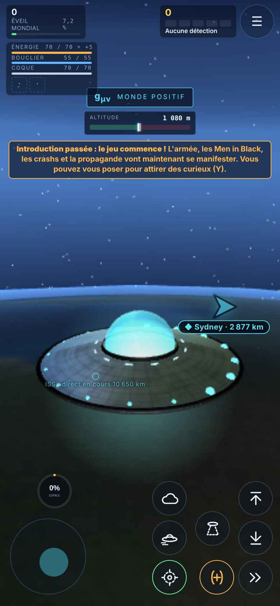

<div align="center">



# Soucoupe Janus

**Éveillez l'humanité. Disparaissez sous ses yeux.**

Jeu 3D gratuit, directement dans le navigateur, sur ordinateur, tablette et mobile.
Disponible en français, en anglais et en espagnol.

### [▶ Jouer maintenant](https://soucoupejanus.github.io/soucoupe-janus/)

</div>

---

## Le jeu

Vous pilotez une soucoupe capable d'**inverser sa masse** et de basculer dans un univers jumeau, le monde négatif. Votre but : **éveiller un maximum de consciences humaines** et faire comprendre à la Terre entière que les ovnis existent, sans que personne ne le prenne à la légère.

Montrez-vous aux témoins, puis disparaissez sous leurs yeux. Tracez des agroglyphes, contactez des humains, échappez à l'armée et déjouez la propagande, de Roswell aux confins du système solaire. Atteignez **90 % d'éveil mondial** pour gagner, puis continuez si vous voulez aller plus loin.

<p align="center">
  
  
</p>

## Ce qui vous attend

- **Deux mondes, une seule hypersurface.** Dans le monde négatif, vous êtes invisible, intouchable, et les trajets sont jusqu'à 1 000 fois plus courts.
- **Une campagne en 5 chapitres :** Roswell 1947, la forêt de Rendlesham, les lumières de Phoenix, le Tic Tac du Nimitz, puis la divulgation. Chaque chapitre se lance quand vous le décidez.
- **Une Terre vivante :** villes, fermes, villages, radars, bases militaires, silos nucléaires, cycle jour et nuit, météo et saisons.
- **Des témoins et des réseaux sociaux :** les passants filment, publient et commentent. La presse et la propagande réagissent en direct.
- **13 sites des civilisations disparues** à découvrir : Gizeh, l'île de Pâques, Stonehenge, Carnac, Göbekli Tepe… et un artéfact unique à la clé.
- **Des laboratoires secrets** sur Terre, et quelques lieux que seuls les plus curieux trouveront.
- **Des simulations scientifiques** dans l'encyclopédie (touche I) : la naissance des galaxies selon le modèle Janus, et une exploration 3D du feuillet négatif.
- **Le système solaire entier :** la Lune, les planètes et les conglomérats de masse négative, à l'échelle réelle des distances.
- **Une progression :** plusieurs vaisseaux, des améliorations, un rang de pilote, des succès, des missions et le courrier d'Ummo.

<p align="center">
  
  
</p>
<p align="center">
  
  
  
</p>

## Commandes

### Sur ordinateur

| Touche | Action |
|---|---|
| Z Q S D (ou W A S D) | Se déplacer |
| R / F (maintenir), molette | Monter / descendre (F au-dessus de la mer : plonger) |
| Souris (clic) ou flèches | Orienter la vue |
| Maj | Boost |
| Espace (maintenir) | Charger la coque, puis relâcher en phase pour changer de monde |
| E (maintenir) | Rayon d'abduction (à basse altitude, dans le monde positif) |
| G | Relâcher un occupant de la soute |
| Y | Agir : se poser, contacter, tracer un agroglyphe, rejoindre une escadrille… |
| H / V | Propulsion MHD / camouflage en nuage |
| X | Stabiliser (stopper l'inertie) |
| N / C / B | Astre suivant / ville / s'orienter vers la cible |
| M / T | Carte / réseaux sociaux et médias |
| L / U / J | Laboratoire / améliorations / missions |
| O / I | Courrier d'Ummo / encyclopédie Janus |
| 2 / 3 · 4 · 5 | Vue normale ou éloignée · vision thermique · mode photo |
| P ou Échap | Pause |

### Sur téléphone et tablette

Un joystick à gauche pour se déplacer, un glissement du doigt sur l'écran pour regarder autour, et des boutons à droite : monter, descendre, boost, charge, rayon, agir, MHD, nuage et relâcher. Le bouton **Carte** ouvre la carte et la liste des lieux (onglet **📍 Lieux**) : touchez un lieu, ou un nom affiché en vol, et la soucoupe s'oriente vers lui. Un bouton **Labo** apparaît quand du bétail ou un humain est à bord, et le menu ☰ regroupe missions, améliorations, sciences et réglages.

> **Installer le jeu :** le bouton **📲 Installer le jeu** (écran d'accueil, ⚙ Options) l'ajoute à l'écran d'accueil du téléphone ou de l'ordinateur. Il s'ouvre ensuite en plein écran, comme une application.
>
> **Sur iPhone ou iPad :** ouvrez le jeu par son lien dans Safari. L'aperçu de l'app Fichiers ou d'une pièce jointe n'exécute pas les scripts, et le jeu ne peut pas y démarrer. Pour le lancer comme une application, utilisez Partager puis « Sur l'écran d'accueil ».

## D'où vient le jeu

Le jeu s'inspire du **Modèle Cosmologique Janus** de Jean-Pierre Petit, mis au propre par Hicham Zejli, et de la bande dessinée *Le Metaphysicon*. Ses règles en reprennent les idées :

- **Deux mondes, une hypersurface.** Le monde positif suit la métrique g<sub>μν</sub>, le monde négatif la métrique h<sub>μν</sub>. Les deux familles de géodésiques ne se croisent jamais.
- **Loi d'interaction Janus.** Les masses de même signe s'attirent, les masses de signes opposés se repoussent.
- **c₋ ≈ 10 c₊.** Côté négatif, la lumière va plus vite et les distances sont contractées.

L'encyclopédie du jeu (touche I) détaille le modèle avec des schémas et un quiz. C'est un jeu, pas un cours : certaines libertés sont prises pour le plaisir de jouer.

## Technique

- **Un seul fichier :** `index.html`. Le moteur 3D [Three.js](https://threejs.org/) r128 et les polices sont chargés depuis un CDN, une connexion Internet est donc nécessaire.
- **Aucune installation :** fonctionne dans tout navigateur récent (Chrome, Edge, Firefox, Safari).
- **Sauvegardes :** elles restent dans le navigateur de chaque joueur. Rien n'est envoyé à un serveur.
- **Qualité graphique** automatique, réglable dans le menu (basse, moyenne, haute). Un mode compatibilité se propose si l'appareil peine à démarrer le jeu.

### Héberger sa propre copie

1. Créez un dépôt public sur GitHub et déposez-y `index.html`, `manifest.webmanifest`, `sw.js` et le dossier `icons` (ainsi que ce README et le dossier `docs` si vous le souhaitez).
2. Dans **Settings → Pages**, choisissez **Deploy from a branch**, la branche **main** et le dossier **/ (root)**.
3. Au bout d'une à deux minutes, le jeu est en ligne à l'adresse `https://votre-pseudo.github.io/nom-du-depot/`.

## Structure du dépôt

```
index.html            le jeu complet
manifest.webmanifest  nom, couleurs et icônes pour l'écran d'accueil
sw.js                 service worker (installation du jeu sur l'appareil)
icons/                icône du jeu (favori, onglet, écran d'accueil)
README.md             cette page
sims/                 simulations interactives de l'encyclopédie (galaxies, feuillet négatif)
docs/affiche.jpg      l'affiche du jeu
docs/captures/        captures d'écran
```
